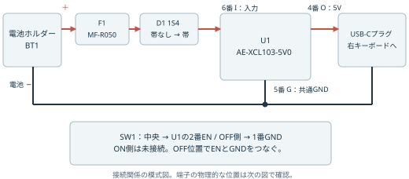
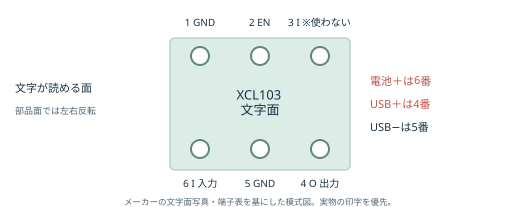
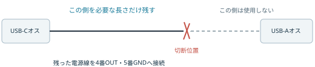
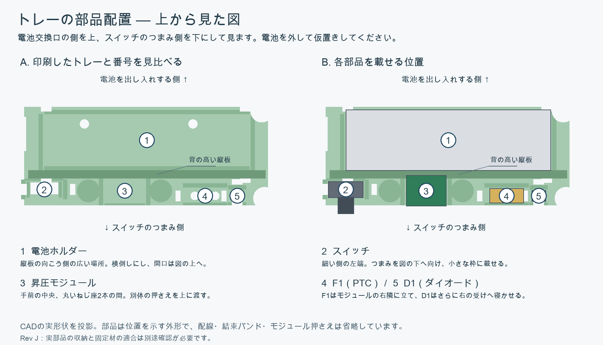

# USBケーブル加工・配線手順書

komoro 単4テンティングバー Rev J / 2026-10-18更新

右バーに単4電池1本とAE-XCL103-5V0を入れ、短く加工したUSB-Cケーブルで右キーボードへ給電する手順です。USB-A側は使いません。左バーには配線しません。

これはメーカー資料と現行設計に基づく試作手順です。2026-10-18に製作者から270Ω負荷時4.9Vと実キーボードの動作確認が報告されました。収納、長時間の発熱、電池寿命は未確認です。まずケース外で配線と出力を確認し、それから収納します。

[印刷用PDF](../../output/pdf/battery-tenting-bar-wiring.pdf) / [購入チェックリスト](BATTERY-TENTING-BAR-CHECKLIST.md) / [部品表](BATTERY-TENTING-BAR-PARTS.md) / [ケース組立](BATTERY-TENTING-BAR.md)

## 0. 作業を始める前にそろえる工具・検査用品

**下表を確認してから、ケーブルの切断へ進んでください。** 手持ちがなければ用意するものです。電源部品480円の小計には、工具・検査用品・試験用抵抗・配線や絶縁用品・送料は含まれていません。

| 区分 | 道具・検査用品 | 使うところ・必要な機能 |
|---|---|---|
| 加工・配線に必要 | はんだごて、こて台・クリーナー、はんだ、フラックス | モジュール・スイッチ・保護部品・ホルダーの配線 |
| 加工・配線に必要 | ニッパ、細い線に対応するワイヤストリッパ | ケーブル切断、外被とAWG26〜28線等の被覆をむく |
| 絶縁に必要 | 熱収縮チューブを収縮できる加熱具 | 接合部の絶縁。PLA部品の外で作業する |
| 測定に必要 | テスターと付属プローブ | 導通、抵抗、ダイオード、直流電圧。電池電流の評価には直流電流機能も必要 |
| この測定方法に必要 | USB-Cメスの全ピン引き出し基板 | VBUS・GND・CC1・CC2をテスターで測れるようにする。次段落の商品例を参照 |
| 電池による検査にも必要 | [両端クリップ付きコード](https://akizukidenshi.com/catalog/g/g104352/)、仮配線10cm×4本、表示用テープ等 | コードは電圧・抵抗負荷検査で4本使用。仮配線は購入するより線から取り分ける |
| 初回試験の保護用として推奨 | 電流制限付き直流電源 | 手持ちにあれば使う。1.5V、100mA/200mA制限。なければ手順9の単4電池で確認 |
| 通電試験に必要 | [1kΩ](https://akizukidenshi.com/catalog/g/g125102/)と[270Ω](https://akizukidenshi.com/catalog/g/g125271/)の抵抗、各0.25W以上、使用各1本 | 約5mA/18.5mA負荷で出力を確認。完成品に内蔵しない |
| 収納・組立に必要 | ねじに合うドライバー、ノギス | M2ねじの固定、ケーブル外径と部品寸法の確認 |
| 作業補助として推奨 | 拡大鏡、保持治具、ピンセット、はんだ吸取線 | 細い端子のはんだ付け・修正と隣接端子の短絡確認 |
| 詳しい動作評価用 | オシロスコープ等 | 起動時の瞬間的な電圧降下を確認。配線加工だけには不要 |

**「検査基板」は、USB-Cの細かい端子を、テスターのプローブを当てやすい端子へ引き出す道具です。** プラグを差し込み、基板上の電源端子や検出端子を測ります。専用の測定機器や、バーに追加する電源回路ではありません。

商品例は[秋月AE-USB-TYPE-C-DIP24（全ピン版）](https://akizukidenshi.com/catalog/g/g113471/)（確認時500円、USB-Cコネクター実装済み）です。完成したバーへ内蔵しません。同等の端子へアクセスできる検査道具が手持ちにあれば、同じ商品を購入する必要はありません。基板のCC端子に5.1kΩ等の抵抗がつながっていると今回の測定に影響するため、商品と回路図を確認します。

工具以外に、手順1の部品・配線・熱収縮チューブ・薄い絶縁シートと、収納用の印刷部品・磁石・ねじを用意します。**結束バンドの適合商品はまだ未確定**です。ケースへ収納する前に固定材の適合を確認する必要があります。

## 1. 用意するものと完成形

| 記号 | 部品 | 接続での役割 |
|---|---|---|
| BT1 | GB-BH-4X1-WP、単4アルカリ電池1本 | 電池の＋と−を取り出す |
| F1 | MF-R050 | 電池の＋直後へ直列に入れる補助保護部品。極性なし |
| D1 | 1S4 | 帯のない側が入力、帯のある側が昇圧モジュール側 |
| U1 | AE-XCL103-5V0 | 電池の電圧から5Vを作る |
| SW1 | SS12D01G4 | U1のENとGNDをつないでOFFにする |
| CABLE1 | LDUC2611-0.5m | USB-C側だけ残し、電源線2本をU1へはんだ付け |
| 配線・絶縁 | AWG26〜28より線、熱収縮チューブ、薄い絶縁シート | 接続と接合部の絶縁 |

工具と検査用品は手順0に記載しています。はんだ付けと収縮チューブの加熱はPLA部品の外で行います。

ケーブルの識別と検査には、手順0のUSB-C検査基板を使います。[回路図](https://akizukidenshi.com/goodsaffix/AE-USB-TYPE-C-DIP24_sch.pdf)で、+V（VBUS）・GND・CC1・CC2を確認します。基板のCCへ外付け抵抗やLEDを追加しません。

手順書の「+V」は基板上の「VBUS」です。以下の端子へ測定用線を付けます。色は識別用なので、同じ色しかなければ両端に名前を表示します。

| 基板の端子 | 測定用線の表示 | 色の例 |
|---|---|---|
| 11番VBUS | VBUS | 赤 |
| 13番GND | GND | 黒 |
| 15番CC1 | CC1 | 白 |
| 14番CC2 | CC2 | 黄 |

11番・12番・下端のVBUS穴は同じ電源端子、13番と下端右側のGND穴は同じGNDです。それぞれ1か所へ配線すればよく、この手順では11番と13番を使います。

### 検査基板の測定用線を準備する

1. ケーブル・電池・電源をつながず、+V・GND・CC1・CC2の穴へ絶縁より線を1本ずつ、約10cmではんだ付けします。4本とも名前を表示し、隣の端子との短絡がないことを測ります。
2. 線のもう一端は約2〜3mmだけむきます。裸の先端同士が触れないよう離して保持し、使わない先端は絶縁テープ等で覆います。基板の隣り合う穴へクリップを直接並べて挟みません。
3. クリップ付きコード1本の両端の金属部分へ、テスターの赤・黒プローブをそれぞれ当てます。導通モードでつながることを、使うコードごとに確認します。この段階ではUSBケーブルも電池も使いません。

この方式では検査用ピンヘッダ・ソケット・ブレッドボードは不要です。仮配線は検査基板に残し、完成したバーへ入れません。

線の先は対応するワイヤストリッパで約3mm剥き、銅線を軽くまとめます。切れた芯線や傷があれば、その部分を切り落としてやり直します。

動作確認には、単4電池と1kΩ・270Ωの抵抗（各0.25W以上）を使えます。電流制限付きの1.5V直流電源が手持ちにあれば初回確認に使います。短絡させて保護動作を試す工程はありません。

USBケーブルから取り出す電源線は、U1の**4番OUTと5番GND**へつなぎます。電池の線はUSBケーブルへ直接つながず、F1・D1・U1を経由させます。

## 2. 電池を外し、各部品の端子を確認する

以降、はんだ付けや抵抗測定の間は電池を外し、電源も切り離します。ケーブルはPC・充電器・キーボードのいずれにも接続しません。

図は文字面の「XCL103」を正立させた向きです。部品面から見ると左右が反転します。実物のI・G・O・ENの印字と[メーカー説明書の1ページ目](https://akizukidenshi.com/goodsaffix/AE-XCL103_20220802_web.pdf)を合わせて確認してください。番号はモジュール外部の端子番号で、IC本体のピン番号ではありません。

| U1端子番号 | 印字 | 今回の接続先 |
|---|---|---|
| 1 | G | SW1のOFF側端子 |
| 2 | EN | SW1の中央の共通端子 |
| 3 | I | 未接続。EN用の電源端子なので電池入力に使わない |
| 4 | O | USBケーブルのVBUS線（＋5V） |
| 5 | G | USBケーブルのGND線と電池ホルダーの−線 |
| 6 | I | D1の帯側の線（電池からの入力） |

1番と5番のGNDはモジュール上でつながっています。5番へ入れる2本は、より線の束が端子穴へ無理なく入るか確認します。入らなければ、近くで電池−線とUSBのGND線を接合し、1本の短い線で5番へ接続します。分岐接合部も熱収縮チューブで絶縁します。

GB-BH-4X1-WPはケースの＋/−表示を見て端子を識別します。表示が分かりにくければ、電池を入れて端子間の直流電圧を測り、赤プローブ側が＋のときに正の値が出る組み合わせを記録します。確認後、すぐに電池を外します。

## 3. 切断前にUSB-Cプラグの抵抗を測る

1. USB-Aプラグは何にもつながず、USB-Cプラグだけ検査基板へ挿します。
2. テスターを抵抗レンジにし、CC1と+V、CC2と+Vの間をそれぞれ測ります。
3. 一方が**53.2〜58.8kΩ（56kΩ±5%）**で、もう一方が未接続であることを確認します。
4. USB-Cプラグを抜いて裏返し、再度挿します。同じ抵抗値が反対側のCC端子へ移ることを確認します。
5. +VとGNDが短絡していないことも確認します。

測定時のクリップ1本は11番VBUSの測定用線と赤プローブ、もう1本は15番CC1の測定用線と黒プローブをつなぎます。CC2を測るときは黒側だけ14番CC2の線へ付け替えます。裏返したときに「約56kΩ」と「OL／未接続」が入れ替わるのが正常で、0Ωは未接続を意味しません。

この抵抗はC側プラグ内にあるため、正しい構造ならA側を切っても残せます。値が違う、測れない、裏返したときに結果が合わない場合は、測定基板の回路とケーブルを確認し、適合を確認できるケーブルへ差し替えます。未確認のままキーボードへ接続しません。

抵抗の値と配置は[USB-IFのType-C仕様・3.5.2節](https://www.usb.org/sites/default/files/USB%20Type-C%20Spec%20R2.0%20-%20August%202019.pdf)に基づきます。提案した[ケーブルの商品ページ](https://akizukidenshi.com/catalog/g/g117017/)には内部抵抗の記載がないため、この確認を省略しません。

## 4. 仮合わせして、USB-C側を残して切る

1. 電池を入れず、ホルダーとU1を右トレーへ仮置きします。
2. U1の4番・5番付近からケーブル保持台座、出口、右キーボード端子までの経路を合わせます。測定後はいったんキーボードからプラグを抜きます。
3. C側プラグから測って、内部配線分・外側経路・はんだ付けと曲げの余裕を含めた位置へ印をつけます。最初は余裕を残し、仮合わせ後に詰めます。
4. 印の位置で切り、**USB-Cプラグが付いている側**を残します。USB-Aプラグ側は保管しても構いませんが、完成品には接続しません。
5. 切断面から外被を約15〜20mmだけむきます。内部の細い線へ刃を当てないよう、浅く切り込みます。

CADの外側経路長は約92mmです。これはプラグ根元からバー出口までの曲線の参考値で、内部配線を含みません。実物のプラグと曲げ方で変わるため、92mmでそのまま切らないでください。元の500mm全部を収納する必要はありません。

## 5. 切った線をテスターで識別する

1. 残したC側プラグを、再び無給電の検査基板へ挿します。
2. 各線の先を約2〜3mmむき、より線を軽くまとめます。
3. 基板の+Vに片方のプローブを当て、各線へもう片方を当てます。低抵抗で導通する線を**VBUS**と表示します。
4. 基板のGNDについて同じことを行い、その線を**GND**と表示します。プローブ同士を触れた値に近い、安定した抵抗値を確認します。
5. プラグを裏返してもVBUS・GNDの識別が変わらないことを確認します。
6. 切断後もCC抵抗が手順3と同じであること、VBUS線とGND線が短絡していないことを確認します。

赤が＋、黒が−とは限りません。色だけで決めず、導通で決めます。外被の編組シールド・ドレイン線をGNDの代わりに使わず、GND端子へ導通する絶縁された電源線を使います。複数の導体が同じ電源端子へ導通する構造なら、線の役割と束ね方を確認してから進めます。

残りのD+/D−などの線は短く切り、**1本ずつ個別に絶縁**します。シールドやドレイン線の切り端も絶縁し、裸線が電源線や基板へ触れないようにします。Cプラグ内のCC抵抗が確認できていれば、今回ケーブルからCC線を取り出して配線する必要はありません。

## 6. スイッチのON/OFF側を決める

SS12D01G4は3本の電気端子を持ち、中央が共通端子です。金属ケースや固定用の部分を配線端子と取り違えないでください。[メーカー図面](https://akizukidenshi.com/goodsaffix/SS12D01G4-G_2.pdf)の回路図も確認します。

1. 3本を「端A・中央・端B」と仮に呼びます。
2. 完成品でOFFにしたいレバー位置へ動かします。
3. 中央と端A、中央と端Bを導通測定し、つながる端を**OFF側**と表示します。残りはON側です。
4. 反対へ動かし、中央とOFF側が未接続になることを確認します。

中央をU1の2番ENへ、OFF側をU1の1番GNDへつなぎ、ON側は未接続で個別に絶縁します。レバーの左右だけで端子を決めないでください。U1はENが開放ならON、ENをGNDへ落とすとOFFになります。このOFFは出力を止める操作で、電池を物理的に切り離すものではありません。

## 7. ケース外ではんだ付けする

接合する「線」は主に用意した柔らかいより線です。スイッチ等の硬い脚は接続先の端子で、端子を短く切る指示ではありません。スイッチ用はまず約5cmを2本用意し、片端をスイッチへ付けてからトレーへ仮置きし、もう片端の長さを調整します。

**はんだ付けする前に熱収縮チューブを線へ通し、熱の届かない位置へ退避させます。** より線と部品リードを少量のはんだで予備はんだします。冷えたら、端子・はんだ・裸の銅線を覆い、線の被覆にも少し重なる位置へチューブを滑らせます。端子ごとに個別に覆い、ヒートガン等の温風で収縮させます。はんだごてをチューブへ直接当てません。PLA部品の外で作業します。

線はモジュールの穴へ直接接続し、付属ピンヘッダは取り付けません。

チューブは1.5・2・3mm等から、実際の線と接合部へ通せて収縮後に密着する径を選びます。細い未接続線に大きい径を使って緩む場合は、適切な径か薄い絶縁テープで個別に覆います。

次の順序で接続します。すべて電池・電源を外した状態で行います。

1〜4と7・8は用意したより線で端子間をつなぎます。5・6はUSBケーブルから取り出して識別した電源線をそのまま使います。

| 順番 | 接続元 | 接続先 | 確認する点 |
|---|---|---|---|
| 1 | BT1の＋線 | F1の片方の脚 | F1をホルダー＋の近くへ置く |
| 2 | F1のもう片方の脚 | D1の帯のない側（アノード） | F1の向きはどちらでもよい |
| 3 | D1の帯のある側（カソード） | U1の6番I | 3番Iへ接続しない |
| 4 | BT1の−線 | U1の5番G | USBのGNDと同じ電位へ接続 |
| 5 | ケーブルのVBUS線 | U1の4番O | 電池側のIへ接続しない |
| 6 | ケーブルのGND線 | U1の5番G | 2本の接続・分岐方法は手順2を参照 |
| 7 | SW1の中央端子 | U1の2番EN | スイッチの電気端子3本の中央 |
| 8 | SW1のOFF側端子 | U1の1番G | OFF位置で中央と導通する端 |

U1の3番I、SW1のON側、ケーブルの不要線は未接続です。接合部を絶縁し、モジュール下面には薄い絶縁シートを配置します。U1は2.54mmピッチなので、はんだが隣の端子へつながっていないか拡大して確認します。内蔵コンデンサは実装済みのため、最初の配線に追加コンデンサは入れません。

D1の帯がカソードを示すことは[1S4データシート](https://akizukidenshi.com/goodsaffix/1S4.pdf)、U1の番号・EN動作・実装済み部品は[U1説明書](https://akizukidenshi.com/goodsaffix/AE-XCL103_20220802_web.pdf)に基づきます。

## 8. 通電前の検査

電池・電源を外したまま、次を確認します。

- USB-C検査基板の+VからU1の4番O、GNDから5番Gへ、それぞれ導通する。
- BT1の−からU1の5番Gへ導通する。
- OFF位置でU1の2番ENと1番Gが導通し、ON位置ではスイッチ単体の接点が開く。U1へ配線した後は内蔵抵抗の経路があるため、ONを単純な「無限大抵抗」とは判定しない。
- D1は帯がU1側に向く。必要なら片脚を外した単体でダイオード測定し、赤を帯なし側・黒を帯側にしたときだけ順方向の値が出ることを確認する。
- 電池＋/−、U1の入力/GND、出力/GNDの間に持続する低抵抗の短絡がない。コンデンサの充電で一瞬鳴ることはあるため、値が変化するかも見る。
- 露出した編組、不要線、SW1未使用端子、ホルダー端子、分岐接合部が絶縁されている。

配線済みのON/OFF確認では、抵抗測定でU1の2番ENと1番GNDへ当てます。OFFはプローブ同士を触れた値に近いほぼ0Ω、ONはOFFより抵抗が大きくなるかを見ます。ONでもほぼ0Ωが続く場合は接点・配線・はんだの短絡を調べます。

短絡確認は抵抗測定で、BT1＋とBT1−、U1の6番Iと5番GND、4番OUTと5番GNDを測ります。各組で数秒待ち、赤黒を入れ替えても確認します。ほぼ0Ωが続けば通電しません。kΩ・MΩやOLの表示はそれだけで短絡とは判断せず、コンデンサや半導体の影響もあるためすべてOLを要求しません。

D1はまず帯側がU1の6番Iにつながることを目視します。片脚を外した単体測定は向きや測定結果が不明な場合の切り分けです。ダイオード測定モードで赤を帯なし・黒を帯あり側へ当てると一般に順方向の電圧値、逆向きではOLです。確認後は配線と絶縁を復旧します。

## 9. キーボードをつながず出力を測る

**この手順で測るのは直流電圧（V）です。1kΩ・無負荷・270Ωのすべてで、テスターは直流電圧測定のまま使います。抵抗を交換してもmA/Aへ切り替えません。** 電池を外した状態で、黒コードはCOM、赤コードは使用機種の電圧測定用差込口へ接続します。差込口が電流用と兼用の場合は説明書に従います。電流測定の設定・差込口でVBUSとGNDの間へつなぐと短絡になります。[テスターメーカーの説明](https://assets.fluke.com/manuals/187_189_umeng0200.pdf)

単4電池でも無負荷・抵抗負荷・ON/OFFの確認はできます。電池は電流を指定値に制限できないため、手順8の無給電検査とF1・D1を含む配線を先に確認します。電流制限付き電源は初回の配線ミス時の保護に有用ですが、この基本確認のために新しく購入する必須品にはしません。

### 単4電池で確認する場合

使う1kΩ・270Ω抵抗は、小さな本体の両側に脚がある検査用部品です。使用は各1本、0.25W以上。＋/−の向きはありません。1kΩは1,000Ωです。袋の表示や、回路へつながず測った抵抗値で識別します。

1. キーボードを外し、SW1をOFFにします。電池もまだ入れません。
2. USB-C検査基板へプラグを挿し、+V・GNDの測定用線と1kΩの抵抗の両脚を、クリップ付きコード2本でそれぞれつなぎます。別の2本でテスターの赤・黒プローブを保持します。手を離しても裸の金属同士が触れないよう保持します。
3. テスターを直流電圧（DC V）にし、赤を11番VBUS（+V）、黒を13番GNDへ当てます。表示単位とコードの差込口を確認してから、新しい単4アルカリ電池1本を正しい極性でBT1へ入れます。
4. ONにして、最初は数秒で出力と発熱の有無を確認します。正の約5V、試作の合格目安は**+4.75〜+5.25V**です。範囲外、負の電圧、電池・部品・線の異常な発熱があればOFFにして電池を外します。
5. 1kΩをつないだままOFFにし、出力が0V近くまで下がることを確認します。電池を外します。
6. 1kΩを外して無負荷にし、電池を入れ直してONの出力を確認します。確認後はOFFにして電池を外します。無負荷では出力コンデンサの電圧がしばらく残る場合があります。
7. 電池を外した状態で、1kΩをつないでいたクリップへ270Ωの抵抗を付け替えます。テスターは直流電圧のまま、赤は11番VBUS、黒は13番GNDにつなぎます。電池を入れ直してONにし、**+4.75〜+5.25V**を保てるか確認します。ここでもmA/Aには切り替えません。抵抗はどちらも0.25W以上を使います。
8. 測定後はOFFにして電池を外します。抵抗の交換、配線変更、導通・抵抗測定は電池を外した状態で行います。

電圧測定の接続は次の4本です。抵抗の交換時は3・4本目だけ付け替えます。

| クリップコード | 接続するもの同士 |
|---|---|
| 1本目 | 11番VBUSの線と赤プローブ |
| 2本目 | 13番GNDの線と黒プローブ |
| 3本目 | 11番VBUSの線と抵抗の片脚 |
| 4本目 | 13番GNDの線と同じ抵抗のもう片脚 |

F1は熱で動作する補助保護部品で、配線ミスの電流をすぐに100mA等へ制限するものではありません。電池での試験は、電流制限付き電源と同じ保護がある試験ではありません。[F1メーカー資料](https://akizukidenshi.com/goodsaffix/mfr.pdf)

### 電流制限付き電源が手持ちにある場合

電池を外し、BT1の＋/−配線入口へ電源をつなぎます。1.5V・100mA制限で1kΩ負荷と無負荷を確認し、270Ω負荷では一度電源を切ってから200mA制限へ変更します。F1・D1を含む回路を試し、電池と電源を同時につなぎません。制限動作中は正常に出力できたとは判定せず、短絡・極性・入力電圧を確認します。

どちらの方法でも、抵抗負荷を通っただけではキーボード起動・無線動作の電力が足りることまでは確認できません。昇圧するため、電池側の電流はUSB側の電流より大きくなります。F1とD1の電圧降下もあるため「U1は0.9V入力対応」から「電池が0.9Vまで使える」とは判断しません。電池低電圧遮断や独立したUSB出力の電流制限も本構成にはありません。

## 10. キーボードで確認し、ケースへ収める

上図の1が横倒しの電池ホルダー、手前の列は左から2のスイッチ、3の昇圧モジュール、4のF1、5のD1です。固定の前に、電池を外してこの位置へ仮置きします。

1. 検査基板と抵抗負荷を外します。SW1をOFFにし、USB-Cプラグを右キーボードへ接続します。別のUSB電源を同時につながず、キーボード側へ別電池を搭載している場合は回路の電源切替・逆流防止を確認してから試します。
2. ケース外の絶縁した配線でONにし、起動・キー入力・無線接続・スリープ復帰を確認します。起動を繰り返す、異常な発熱ならOFFにして電池を外します。負荷時の5Vと電池電流も評価する場合は、下の測定方法を使います。
3. OFFにして電池を外してから、ホルダー・F1・D1・SW1・U1をトレーへ固定します。**結束バンドの適合品とMF-R050の据え付け高さは未確定**です。購入チェックリストの寸法確認を済ませてから収納し、はんだ付けだけで部品やケーブルを保持しません。
4. U1をモジュール押さえへ、トレーを本体へ固定します。配線は裏面溝へ収め、ねじ・電池・スライド蓋の経路を避けます。
5. 内蓋と上カバーを外した状態で、ケーブルの途中を右本体の上開き溝へ下ろします。USB-Cプラグを小穴へ通す工程はありません。台座で**外被**を保持し、引っ張り力がU1の端子へかからないことを確認します。
6. 内蓋一体の押さえで溝を閉じ、磁石カバーと共締めします。背面蓋を取り付け、電池を入れてON/OFFと電池交換を再確認します。収めるときに線を曲げた後も短絡・断線がないか確認します。

固定材の適合、電池ホルダー・プラグの寸法、実負荷での給電評価が済むまでは、収納と常用の完了とは扱いません。日常の電池交換ではOFFにし、長期間保管するときは電池を取り外します。

ホルダーはバンド2本、スイッチ・F1・D1は各1本で固定します。留め具を上側へ残し、帯を片側の穴から裏へ通し、反対側の穴から上へ戻して部品の上を回します。スイッチは金属本体を押さえ、動くつまみを避けます。ホルダーは電池の出し入れを妨げない位置で留めます。U1は丸いねじ台2本の間に置き、別体の押さえをM2×3.5mmねじ2本で固定します。トレー上のバンドは計5本、ケーブル外皮の保持には本体側で別の1本を使います。

### ケース外での追加測定

負荷時の出力は、直流電圧レンジでU1の4番OUT（赤）と5番GND（黒）の間を測ります。隣の端子に触れそうなら、電池を外して測定用の絶縁線を仮付けし、離れた先端へクリップをつなぎます。測定用線は収納前に外します。起動時の短い電圧降下まで調べる場合はオシロスコープとプローブを使います。

電池電流は、直流電流に対応するテスターを**直列**に入れて測ります。電池側の電流であり、USB出力電流とは異なります。

1. OFFにして電池を外し、BT1の＋とF1の接続を一度外します。必要なら両側に短い絶縁線を付け、クリップで測れる位置へ出します。
2. テスターの説明書に従い、測定端子・許容電流・ヒューズを確認し、適切な高めの直流電流レンジから始めます。
3. BT1＋側→赤プローブ→テスター→黒プローブ→F1という順につなぎます。**電流レンジのプローブを電池の＋/−へ直接当てると短絡します。**
4. 電池を入れてONにし、起動後・無線動作・スリープ時を記録します。測定器の挿入による電圧降下が動作へ影響する場合があるため、測定器なしの動作とも照合します。
5. OFFにして電池を外し、テスターを取り外してBT1＋とF1の接続・絶縁を復旧します。テスターも直流電圧用の端子・レンジへ戻します。

直流電流機能がなければ基本検査を行い、電池電流の評価は未実施として記録します。電流測定や指定電圧での評価を省略した結果から、電池寿命・低電圧時の採用可否までは確定しません。

## 11. 記録と、うまくいかないときの確認先

| 確認項目 | 記録欄 |
|---|---|
| ケーブル型番 / 外径 / C側を残した長さ | __________ / __________ mm / __________ mm |
| CC抵抗・表 / 裏 | __________ kΩ / __________ kΩ |
| VBUS線の色・印 / GND線の色・印 | __________ / __________ |
| 電池電圧 / 保護部品後のU1入力電圧 | __________ V / __________ V |
| 無負荷 / 1kΩ / 270Ω時の出力電圧 | __________ V / __________ V / __________ V |
| OFF＋1kΩ時の出力電圧 | __________ V |
| キーボード起動・無線・復帰 / 入力電流・発熱 | __________ / __________ |

| 症状 | 電源を外してから確認するところ |
|---|---|
| ONでも0V | SW1のOFF側取り違え、ENの短絡、D1の向き、電池極性、6番Iへの接続 |
| 電圧が負になる | テスターの極性、VBUS/GND線の識別、U1の4番/5番 |
| 無負荷は5V、負荷を入れると下がる | 保護部品後の入力、電源の電流制限、電池の消耗、接合不良、U1の出力能力 |
| OFFでも電圧が残る | 出力コンデンサの残留かを1kΩ負荷で確認、SW1の中央/OFF端子 |
| Cプラグを裏返すと動かない | CC抵抗の表裏測定、Cプラグや検査基板の接点、ケーブルの断線 |
| 収納後だけ不安定 | はんだの割れ、外被の保持、配線の挟み込み、裸線とねじの接触 |

接続先の修正、再はんだ付け、導通・抵抗測定は必ず電池と電源を外して行います。

## 12. 今回の試作記録（2026-10-18）

以下は製作者から会話内で報告された結果です。測定器によるログや、全条件を検証した評価ではありません。

| 項目 | 報告された結果 |
|---|---|
| 切断前CC抵抗 | CC1未接続、CC2が55.9kΩ。プラグを裏返すとCC1が56.0kΩ、CC2未接続 |
| ケーブル内のGND候補 | 黒い被覆線と裸線がGNDに導通。電源配線には確認した黒い被覆線を使い、裸線は個別絶縁する方針 |
| BT1＋／−の抵抗 | OFF 118kΩ、ON 未接続 |
| U1の6番I／5番GNDの抵抗 | OFF 98kΩ、ON 2MΩ超 |
| U1の4番OUT／5番GNDの抵抗 | OFF 未接続、ON 98.9kΩ |
| 270Ω負荷のON時出力 | 直流電圧測定で4.9V。途中の67.1mAという表示は測定モードを変更した際の値で、負荷電流の検証結果として採用しない |
| 実キーボードへの接続 | 正常動作が報告された。起動・無線・スリープ復帰の個別結果は未記録 |
| 未確認 | トレーへの収納と固定材の適合、長時間の発熱、電池寿命、指定した低入力電圧での動作 |
