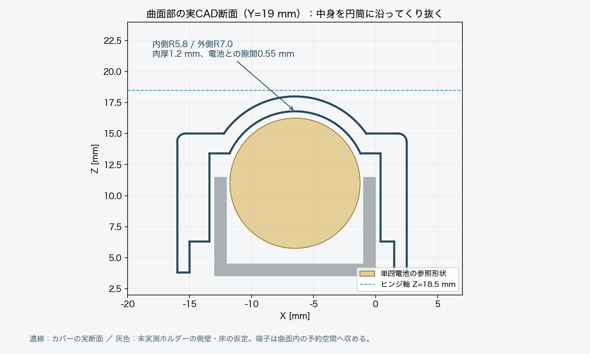
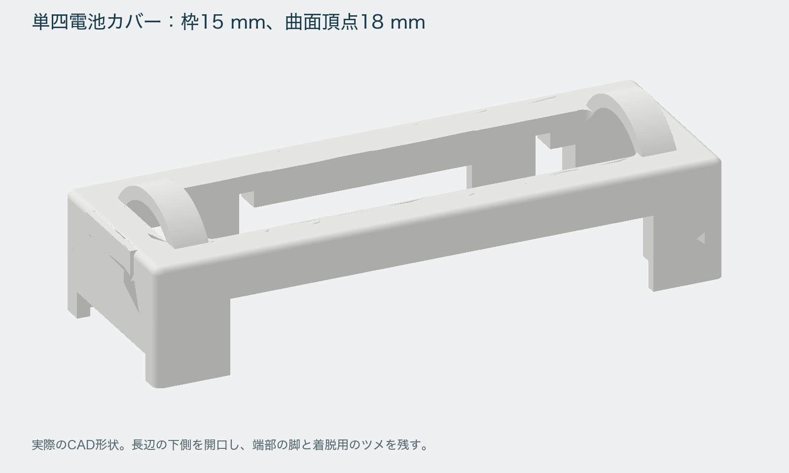
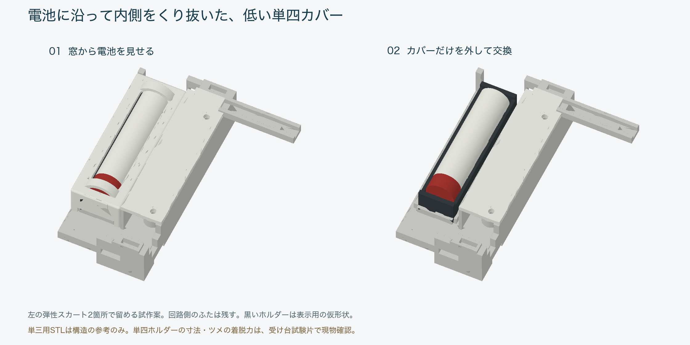

# 電池に沿う薄い着脱カバー

電池中心Z=11 mmを基準に、カバーの内側をR5.8 mmの円筒でくり抜いた。外側は同心のR7.0 mmとし、曲面の肉厚は1.2 mm。単四電池の参照半径5.25 mmに対して、円筒方向の隙間は0.55 mmとした。

高い箱の上に膨らみを載せる構造を廃止し、外枠をZ=15 mmまで下げた。曲面の頂点はZ=18 mmで、以前の23.3 mmから5.3 mm低く、ヒンジ軸Z=18.5 mmより0.5 mm低い。回路側のふた上端はZ=16.3 mm。電池カバーだけを上へ外して交換でき、配線は引き続き下部配線室を通る。

## ホルダーの突出をなくす

ユーザー指定により、必要ならホルダーの余分な樹脂を削って収める前提へ変更した。モデルの両端樹脂壁はZ=13 mm、ホルダー底面から9.5 mm以下とし、白いカバーの下面Z=13.4 mmとの間に0.4 mmの隙間を設けた。元の黒い壁が出ていた上面の貫通逃げは閉じ、カバーの屋根で覆う。カバー外枠15 mm、曲面頂点18 mm、電池位置は維持する。

**削る対象は余分な樹脂だけ。金属接点・ばね・その固定部を削る前提にはしていない。** 接点用の仮定した空間をカバー内側に別途残している。現物で接点保持と絶縁を維持できる範囲を確認し、樹脂の必要な突出だけを少しずつ落とす。底面から9.5 mmはCADの加工後目標であり、実物から一律5.5 mm削る指定ではない。

未加工の13×51×15 mmは従来の未実測外接寸法。今回の加工後モデルは13×51×9.5 mm、床Z=3.5〜4.5 mm、側壁上端Z=11.5 mm、端部樹脂上端Z=13 mm。メーカーの精密モデルではなく、接点形状・固定部・はんだ・絶縁後の寸法は未確認。[製品ページ](https://www.marutsu.co.jp/pc/i/595611/)の確認寸法として扱わない。まず受け台とカバーの試験片で、金属接点を保ったまま加工・収納できるかを確認する。

| 項目 | 寸法・条件 |
|---|---|
| ホルダー外接寸法の仮定 | 加工後の樹脂部13×51×9.5 mm、底Z=3.5 mm（電池は別形状） |
| ホルダー位置 | Y=15.5〜66.5 mm |
| カバー本体 | 幅18.5×奥行53.7 mm（指掛かり込み54 mm） |
| カバー上端 | 外枠15 mm、曲面頂点18 mm |
| 曲面 | 中心Z=11 mm、外側R7.0／内側R5.8 mm |
| 表示窓 | 10.5×41 mm、角R1 mm |
| 端部樹脂／カバー下面 | Z=13／13.4 mm、上面の貫通逃げは廃止 |
| 長辺下側の開口 | 上端Z=11 mm、端の脚とツメを残す |
| 留め方 | 左の弾性スカート2箇所、掛かり0.35 mm |

ツメを外へ少し開いて解除し、手前の指掛かりで持ち上げる想定。低い外枠に合わせてツメの根元も下げたため、以前と同じ着脱力とは限らない。ホルダーは底面に薄い両面テープ等で固定し、カバーと一緒に浮かないようにする。保持力・弾性・摩耗・反復寿命は実物確認前。

先に [カバーSTL](generated/battery_cap.stl) と [受け台試験片STL](generated/fit_battery_cradle.stl) を印刷する。受け台試験片は印刷用に配線室を埋めた形状。カバーは組付け座標で出力する。平らな上面全体を下へ置ける形ではないため、スライサーで向きとサポート、ツメ・嵌合面を確認する。

CADでは部品の有効性とSTLの閉鎖性、開閉46角度の干渉、ホルダー端部上の屋根が閉じていること、接点予約空間の干渉、電池とカバーの最短距離、曲面の実断面、閉状態の左ケース・キーとの距離、ツメ解除後の上方6位置、電池取り出し用空間を確認する。連続運動・端子から電池を外す動作・材料変形の力学解析は含まない。

開いた本体の全高は24.5 mmから22.7 mmへ戻り、収納厚39.4 mmは維持する。添付の単三用STLは被せ構造・曲面・窓の参考で、メッシュ流用や一律縮小はしていない。

保存後のホルダー・接点予約空間・電池に対するカバー持ち上げは `check-battery-service.py` でも確認する。FreeCADでこのスクリプトを実行すると、`generated/battery-service-validation.json` へ結果を保存する。
