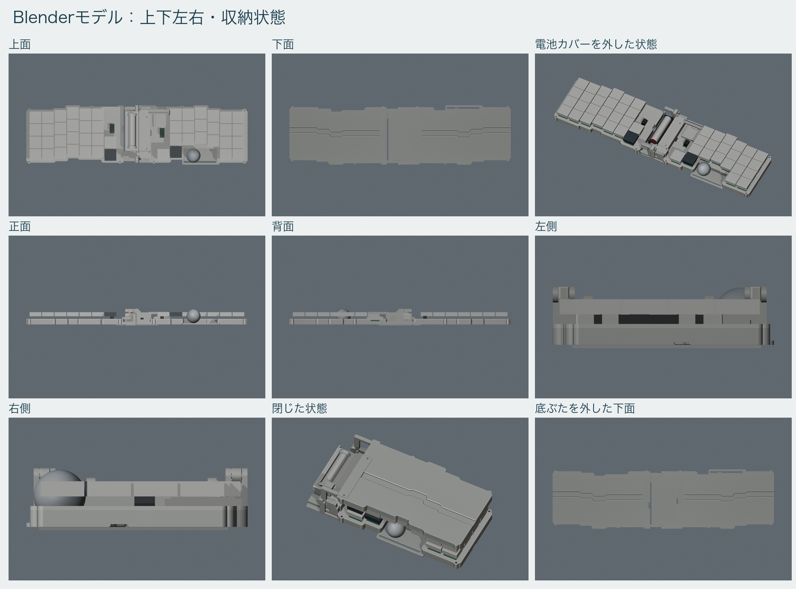

# Blenderで外観を確認する

[komoro-folding-review.blend](generated/komoro-folding-review.blend) をBlenderで開く。Blender 5.0.0で作成・再読込を確認した。ファイル内にメッシュとマテリアルを収録し、外部テクスチャや追加アドオンは使わない。

汎用形式は [komoro-folding-open.glb](generated/komoro-folding-open.glb)。Blenderでは「ファイル → インポート → glTF 2.0」から読み込む。GLBには開いた状態だけを収録する。



電池交換の変更点をすぐ見るには [komoro-folding-battery-access.blend](generated/komoro-folding-battery-access.blend) を開く。電池カバーを外したシーンから表示する別名の確認用ファイルで、同じ4シーンを収録する。既に開いているファイルの表示は、ディスク上の更新だけでは切り替わらないため、ファイルを開き直す。

電池に沿って内側をくり抜いた最新版は [komoro-folding-trimmed-holder.blend](generated/komoro-folding-trimmed-holder.blend)。外枠15 mm、曲面頂点18 mm。黒いホルダー端部は樹脂加工後Z=13 mmの仮定形状とし、閉じた白い屋根の下へ収める。曲面は内側R5.8／外側R7 mmの中空形状で、装着状態から開く。

## シーンを切り替える

画面上部のシーン選択で切り替える。

| シーン | 内容 |
|---|---|
| `01_Open` | 開いた状態。最初に表示される |
| `02_Folded` | キーを内側にした収納状態。CADで必要なキー押下も反映 |
| `03_Underside_covers_hidden` | 底ぶたを非表示にして下部配線室を見る状態 |
| `04_Battery_cover_removed` | 電池カバーのみを外し、ホルダーと交換経路を見る状態 |

右上のアウトライナーで、印刷部品、底ぶた、電源ふた、キー、基板・コネクタ、独立した電池カバー、電池・軸・磁石・ボールを個別に表示切替できる。`Assumed envelopes` は寸法仮定の参照なので初期状態では非表示。印刷用部品には `CAD_part` プロパティで元のSTL名を付けた。

## 上下左右から見る

中ボタンドラッグで回転、Shift＋中ボタンで平行移動、ホイールで拡大縮小する。テンキーがない場合は、3Dビュー右上の軸ギズモや「ビュー → 視点」を使う。

| 視点 | テンキー |
|---|---|
| 上／下 | `7` ／ `Ctrl+7` |
| 正面／背面 | `1` ／ `Ctrl+1` |
| 右／左 | `3` ／ `Ctrl+3` |

各シーンに上下左右・前後・斜めのカメラも入れた。`0` でそのシーンの既定カメラを見る。下面確認シーンの既定カメラは下面。
操作は[Blender公式の視点説明](https://docs.blender.org/manual/en/3.6/editors/3dview/navigate/viewpoint.html)も参照。

## モデルの範囲

印刷部品は現在のSTLから形状を変えずに取り込み、1 mmを0.001 mに換算した。Blenderの表示単位はmm。個別キー、PCB、電池、コネクタ、ボールは元のCADの参照形状で、実際のキーキャップの凹面・刻印や電子部品の精密モデルではない。黒いホルダーは開放型の仮定形状で、メーカーの精密モデルではない。今回の干渉検証もこの仮定形状を使う。

開閉の2状態を確認するためのモデルで、開閉アニメーションやケーブルの連続変形は含まない。ケーブル追従、軸受け強度、ピン抜け止めの実物確認済みを意味しない。
CADのBRep外接寸法は閉状態の幅166.8 mm、STLの頂点範囲は166.6 mmとなる。三角形メッシュを変形して外接寸法へ合わせる処理は行っていない。

## 再生成

CAD生成の後、リポジトリ直下から実行する。

```sh
/Applications/Blender.app/Contents/MacOS/Blender --background --factory-startup --python-exit-code 1 \
  --python 3d-models/folding-unibody/export-blender.py
/Applications/Blender.app/Contents/MacOS/Blender --background --factory-startup --python-exit-code 1 \
  --python 3d-models/folding-unibody/check-blender.py
python3 3d-models/folding-unibody/render-blender-views.py
```

確認画像は `generated/blender-views/`、入力ハッシュと寸法の記録は [blender-validation.json](generated/blender-validation.json)。`.blend` 内の `START_HERE / はじめに` にも簡単な操作説明を入れた。
