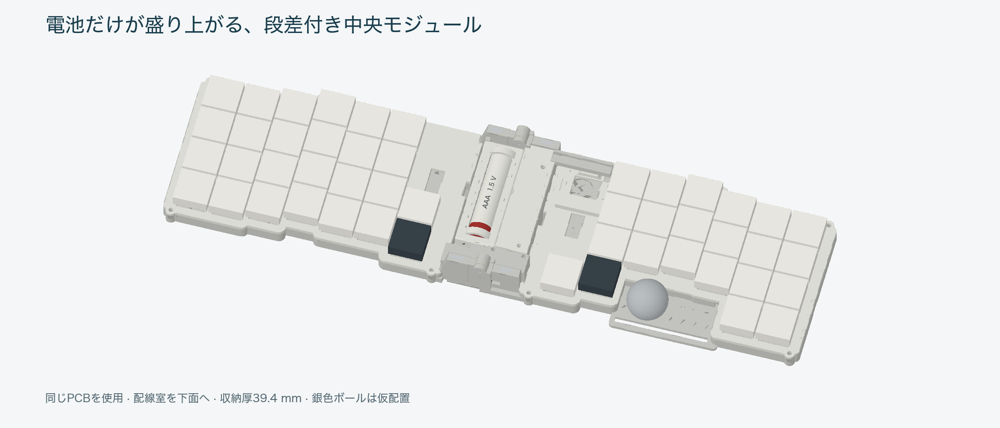
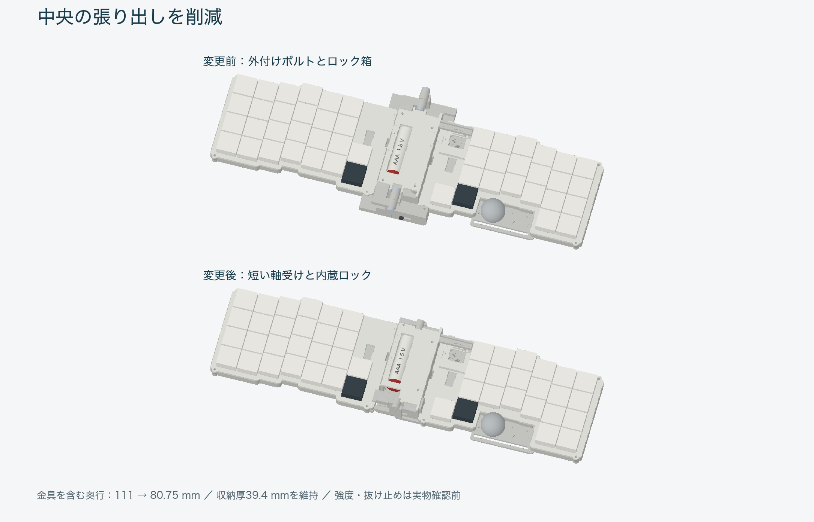

# 中央ジョイントの小型化

前後へ伸びていたM3ボルト・ナットと前側ロック箱を廃止し、中央電源ケースの範囲へ収める。

| 項目 | 変更前 | 現行 |
|---|---|---|
| ヒンジ1か所の軸受け長さ | 12 mm＋外側のボルト・ナット | 8 mm、頭なしピン |
| 軸 | M3×18ボルト | 直径2×長さ7.6 mm金属ピン |
| ヒンジ外径 | 7 mm | 6 mm |
| 軸受け配置（Y） | -14〜-2 / 76〜88 mm | -2〜6 / 68〜76 mm |
| 金具を含む奥行 | 111 mm | 約80.75 mm |
| 回転軸高さ | 18.5 mm | 18.5 mm |
| 収納厚 | 39.4 mm | 39.4 mm |
| ロック解除量 | 6 mm | 4 mm、移動端4.2 mm |

中央の可動軸受けは幅3.4 mm、両側の固定軸受けは各2 mm、隙間は各0.3 mm。ピンは両端を0.2 mm沈める想定で、外にボルト頭やナットを出さない。固定側の端部だけで接着・抜け止めし、可動側へ接着剤を回さない。

ロック箱はX=0〜19.5、Y=4〜13.5 mmの手前側へ移し、ピンの掛かりを3 mm、解除量を4 mmとした。同じC101ばねを使う。電池ホルダー・電池窓は後方へ4.5 mm移動し、電源切離しコネクタとENスイッチの予約位置も調整した。高さは維持する。内側レールは高さ3.5 mmへ下げ、PCB下面Z=4.5 mmとの空間を確保した。

[下部配線](UNDERFLOOR-WIRING.md)の可動口はY=8〜16 mmへ移し、手前の軸受けから離した。電池窓はY=20.5〜61.5 mmで、ケーブルを窓の上へ回す経路は設けない。

中央の回路ふたはM2×4ねじ2本、電池カバーは独立したツメ留め、配線底ぶたは左2本・右5本へ変更した。旧版のトレー・ふた・ロック部品とは混用しない。

**細く短い軸受けの強度、ピンの抜け止め、摩擦・ガタは実物未検証。** 前ヒンジ試験片で回転と保持を確認してから本体を印刷する。CADの干渉検証は、荷重・繰返し耐久の保証ではない。

比較画像は変更前の `preview-mesh.json` を保存し、`python3 3d-models/folding-unibody/render-compact-comparison.py --before 保存したファイル` で再生成できる。

2026-11-22更新：閉じ止めは[前後端に沿うリブ](END-RIMS.md)へ変更。可動側の接触線をZ=19 mmへ下げ、固定側はZ=18 mmとした。軸と金具の寸法は維持する。
