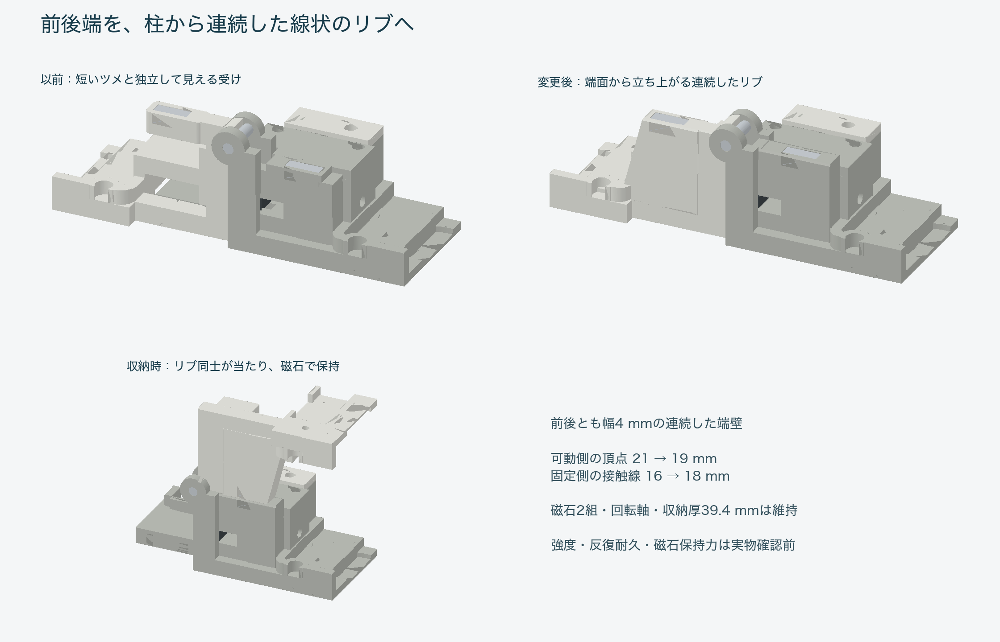

# 前後端に沿う閉じ止めリブ

中央の閉じ止めを、前後端の面から連続して立ち上がる幅4 mmのリブへ変更した。可動側は基板の端を避け、低い端の縁から斜めに立ち上げてヒンジへつなぐ。短いツメと支柱に分かれて見えていた部分を、一続きの端壁として見せる。



| 項目 | 以前 | 現行 |
|---|---|---|
| 可動側の接触線（開状態Z） | 21 mm | 19 mm |
| 固定側の接触線（Z） | 16 mm | 18 mm |
| リブの奥行方向の幅 | ツメ4 mm・根元3.4 mm | 端壁4 mm、軸との境目のみ3.4 mm |
| 上縁 | 短い丸角ツメ | 連続した直線と0.25 mm面取り |
| 保持磁石 | 前後2組・計4個 | 同じサイズ・個数・XY位置 |
| 収納厚 | 39.4 mm | 39.4 mm |

回転軸は引き続きZ=18.5 mm。180°で可動側の線がZ=18 mmへ移り、固定側の線へ当たる。閉じ止めの荷重は本体の端壁へ伝え、着脱する電池カバーと回路側のふたには載せない。閉状態の保持には既存の磁石を使い、開状態の自動ロックと解除ボタンは変更しない。

左側はX=-26〜-19.8 mmをZ=4.3 mmの低い縁にし、PCB下面Z=4.5 mmとの間を0.2 mm空けた。PCB端X=-20.05 mmの外へ出てから斜めに立ち上げる。左上板の内側の張り出しにも、前後それぞれ小さな逃げを設けた。PCB輪郭・固定位置・キー位置は変えず、左トレーと上板は同じ版を組み合わせる。

磁石面は樹脂の接触線から公称0.1 mm奥に沈め、閉状態の磁石同士の隙間0.2 mmを維持する。接触高さが変わったため、旧版と新版の左右トレーを混用しない。

CADで部品とPCBの干渉、180°での接触、181°での閉じ過ぎ防止、磁石の隙間、前側試験片での閉じ止めを確認する。リブと斜めの根元の強度・印刷公差・疲労・保持力は実物未検証。まず前ヒンジ試験片を印刷する。

比較画像を再生成する場合は旧版の `preview-mesh.json` を保存し、次を実行する。

```sh
python3 3d-models/folding-unibody/render-end-rims.py --before 旧版のpreview-mesh.json
```

Blenderの確認用モデルは [komoro-folding-end-rims.blend](generated/komoro-folding-end-rims.blend)。4つのシーンは従来どおり収録する。
