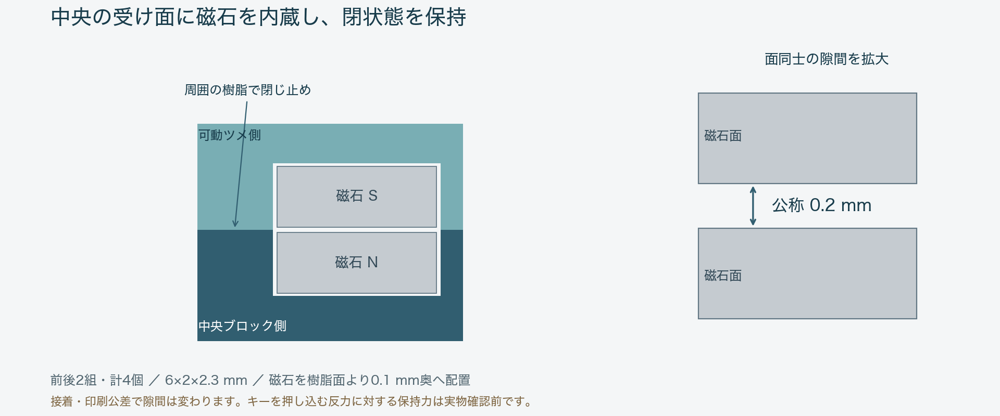

# 閉状態を保持する磁石

中央ブロックの前後の受け面と、そこへ当たる可動側のツメへ、厚み方向に着磁した磁石を1個ずつ入れる。
前後2組、使用数は計4個。外側や内側へ独立した柱を追加せず、軸高18.5 mm・閉じた厚さ37 mmを保つ。

候補は[ネオマグ公式一覧](https://www.neomag.jp/shop/magnets/category_list1.php?cat2_id=1&categorysDir=DESC&categorysOrder=Sorter6&shape_id=4)掲載の**N52・6×2×2.3 mm・2.3 mm方向着磁**。
購入や発注は行っていない。手持ちの12×1 mm丸磁石は、この受け面には入らない。

| 寸法・配置 | 設計値 |
|---|---|
| 磁石 | 6×2×2.3 mm、4個 |
| 接着用ポケット | 6.3×2.3×深さ2.5 mm、4か所 |
| 磁石面の沈み | 樹脂の受け面から公称0.1 mm |
| 接着層の仮定 | 公称0.1 mm |
| 閉じたときの磁石面同士の隙間 | 公称0.2 mm |
| ポケット周囲の最小側壁 | 0.85 mm |
| 可動ツメのポケット底に残す厚み | 1.5 mm |
| 固定側中心位置 | X=12 mm、Y=2/72 mm |
| 軸から磁石までの距離 | 12 mm |

## 保持力を確認する理由

このキーボードは閉じると2キーを各約1 mm押し込むため、磁石はキーの反力に対する開き止めとしても働く。
磁石が軸に近いので、小さな吸着力だけで安定すると断定しない。
例として各キーの反力を0.5 Nと仮定し、軸からの距離を70.05/87.05 mmとすると、開方向のモーメントは約78.6 Nmm。軸から12 mmの磁石2組で受けるには、各組約3.27 Nの吸引が必要になる。
これは力の関係を説明する例で、Specterの1 mm位置の実測反力ではない。ヒンジ摩擦や本体の重量も含まない。

候補磁石の公式掲載吸着力は0.55 kgfだが、[メーカーの測定方法](https://www.neomag.jp/support/qa_list.html?QADB_catid=3&QADB_id=103)は十分に厚い鉄板への垂直引張りである。
0.2 mmの隙間を持つ磁石同士の吸引力や、この筐体を開く力へ、その数値をそのまま使わない。
**実際の安定保持は磁石を入れた本体で確認する。** 前側試験片では、極性、収まり、接着後の吸着と開きやすさを先に確認できる。

## 接着の順序

1. まず接着せず、印刷した前側の受け・ツメへ磁石が底まで収まることを確認する。圧入で薄い側壁を広げない。
2. 閉じた状態で引き合う向きを確認し、対応する2個を一組として面へ印を付ける。前後の組を取り違えない。
3. 一方を薄い接着層で固定し、十分硬化してから対応する側を固定する。接着剤は印刷材料と磁石のメッキに適合するものを使う。
4. 磁石面が樹脂の受け面から出ないことを確認する。磁石同士を直接衝突させたり、はみ出した接着剤で閉角を変えたりしない。
5. キーを押し込む反力がある状態でも勝手に浮かず、指で無理なく開けられることを確認する。

接着層と磁石の実寸で沈み量は変わる。磁石が突出して閉じ止めを受ける状態にはしない。
磁石を挟んでもふたに荷重を掛けず、周囲の樹脂面同士で閉じ止めを受ける。

## 電源連動ロックとの役割

磁石はOFF時の閉状態保持に使う。ON時の展開固定は機械式のロックピンで受ける設計方針。
電源連動機構そのものは、この磁石追加版ではまだ未反映。前側試験片のロックは従来のばね式であり、電源OFFだけで解除される動作を保証するものではない。
