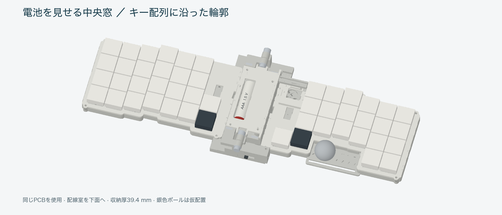
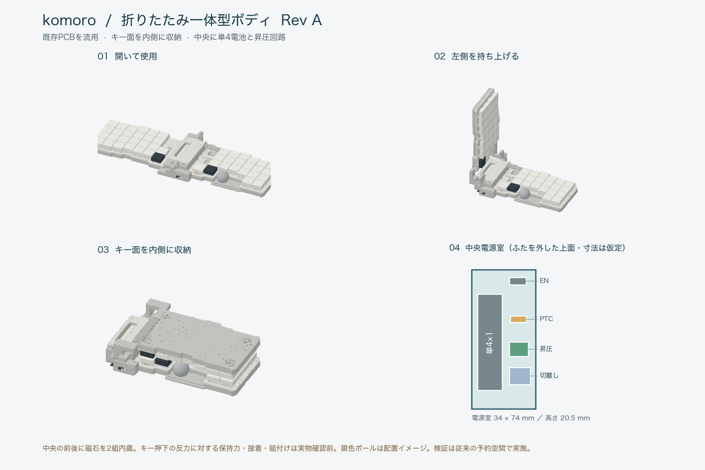

# komoro 折りたたみ一体型ボディ — Rev A

2026-11-21 外観更新。既存の左右PCBをそのまま使う、**組付け・機構確認用の初版**。量産・本体一式の印刷を確定する段階ではない。
中央電源室を右側へ固定し、左側を180°持ち上げ、キー面を内側にして畳む。
開いた位置ではストッパーとばね式ロックピンで固定する設計。





本体一式を印刷する前に、[試し刷り・仮組み手順](FIT-GUIDE.md)で、前側ヒンジと中央の閉じ止め、電源部品の収納、39.4 mmの収納厚を確認する。

## 分割版との管理の分離

このディレクトリに、一体型のスクリプト、説明、FreeCAD、STL、STEP、検証結果をまとめる。
既存の `../FreeCAD/` 以下は分割版として残し、その生成物には書き込まない。
現在の左右KiCad PCBと、分割版の `generate-keyboard-case.py` を読み取り専用で参照し、PCB輪郭、スイッチ位置、固定位置、XIAOカバー、トラックボール固定スロットを引き継ぐ。
PCB自体の変更も行わない。

| ファイル | 内容 |
|---|---|
| [generate.py](generate.py) | FreeCAD用の再生成スクリプト。寸法変更はこちら |
| [render.py](render.py) | 実際のCADの三角形から確認画像を作成 |
| [FreeCAD](generated/folding-unibody-rev-a.FCStd) | 開いた組立、隠した折りたたみ形状、寸法確認用参照、試し刷り部品 |
| [検証結果](generated/validation.json) | 形状、STL、回転サンプル、ロック、電源収納の検証と入力ファイルのSHA-256 |
| [試し刷り手順](FIT-GUIDE.md) | 小さな前側組立、電源室、39.4 mmゲージの使い方とC101の選定根拠 |
| [上面図](generated/top-view.png) | キー列の段差と中央の電池窓 |
| [試験片の図](generated/fit-pack.png) | 開閉位置・電源室・収納厚ゲージ |
| `generated/*.stl` | 印刷候補部品。まず `fit_*_joint.stl` を使う |
| `generated/*.step` | 他のCADへの受け渡し用 |

FreeCADの `Print_*` が本体部品、`Folded_*` は閉じた位置の左部品、`Reference_*` は寸法仮定を含む参照、`fit_*` は試し刷り部品。
閉じた表示にするときは、開いた左部品と `Reference_Keys_left` を隠して `Folded_*` を表示する。`Folded_Keys_left` は接触するキーの押下を反映している。右側は固定。
形状は単純なソリッドとして編集できる。履歴付きのスケッチモデルではない。

## 外観の方針

参考写真に合わせ、白〜薄いグレーの面と、キー列に沿った段付き輪郭を使う。キー領域の外に追加していた長方形の床・前後全幅の縁を取り除き、元のPCB外形に沿うケースを見せる。ヒンジの接続に必要な幅8 mmのレールは中央寄りだけに残す。同じPCBを収めるため、PCBそのものより内側には外形を切り込まない。

中央ふたは電池側に10.5×43 mm・角R1 mmの窓を開け、隣の回路は覆う。電池は従来の位置で、上面はふたより約4.25 mm低い仮定。電池の上面が見える開放型ホルダーを使い、ラベルを上へ向ける。実際のホルダーの側壁・結束バンドが窓を遮らないかは仮組みで確認する。交換はふたを外して行う。

銀色のボールは外観確認用の仮配置。干渉確認には従来の大きい予約空間を引き続き使う。色は印刷色の提案で、キーキャップの実形状・刻印の再現ではない。電池の赤い帯・文字も見せ方の例で、銘柄を指定していない。

## 寸法と前提

| 項目 | Rev A |
|---|---|
| PCB外形の最大幅×奥行 | 左右とも約128.5×74 mm |
| スイッチ位置 | 現在のPCBから左26・右22か所を読込 |
| PCB間の中央幅 | 36 mm |
| 印刷部品だけの開いた外寸 | 約301.2×104×23.2 mm |
| 印刷部品だけの閉じた外寸 | 約166.8×104×39.4 mm |
| ヒンジねじを含む開いた外寸 | 約301.2×111×23.2 mm |
| ヒンジねじを含む閉じた外寸 | 約166.8×111×39.4 mm |
| PCB上面 | 床基準 Z=6.1 mm |
| 回転軸 | 床基準 Z=18.5 mm、前後2か所（従来24 mmから5.5 mm低減） |
| ヒンジ外径・最上部 | 外径7 mm、上端Z=22 mm（従来外径10 mm・上端29 mm） |
| 中央電源室のふた上面 | 床基準 Z=20.5 mm（従来24 mmから3.5 mm低減） |
| キーキャップ最上部（製作者の実測） | PCB上面＋10.5 mm、床基準 Z=16.6 mm |
| ボール・ケースの予約空間の上端 | 床基準 Z=21.3424 mm（既存ケースSTLの上端19.8424＋床1.5 mm） |
| 畳んだときのキー同士の高さ方向の隙間 | 押さない状態で3.8 mm |
| 反対側キーの押し込みを許す量 | 最大2.0 mmの仮定。実際に必要な量は検証JSONに記録 |

製作者が指定した条件は、**トラックボールを残す、分割版と同じスイッチ・キーキャップ（PCB上面から実測10.5 mm）、開くと自動ロックし解除ボタンで畳む方式**。
使用スイッチは製作者指定の **Lofree × Kailh Specter**（入力表記「spector」）。
中央電池室は高さ20.5 mm。キーを押し込んで畳む条件を採用し、軸高さ18.5 mmは維持し、下部配線用の底ぶたを追加した現行版の収納厚は39.4 mm。
キー上部は16×16 mmの箱、ボールとケースは30×21 mmの予約空間で検証している。実際のキーキャップの裏面・張り出し、センサー、ベアリング、ねじ、FFCの全組立形状ではない。

### キーを押し込んで畳む条件

閉じるときにボール・ケースへ当たる左側キーだけ、スイッチの可動範囲内で押し込む。角度ごと・キーごとの必要押下量を `validation.json` に記録する。右側キーは押さない状態で確認する。
現在の包絡・配置では、179.5°でSW33が0.4 mm・SW32が0.3 mm、180°で両キーが1.0 mmの押下を必要とする。他のキーは押さない状態で通過した。0.1 mm刻みで求めた幾何上の値で、実際の接触力や印刷誤差は含まない。
[Lofree公式のSpecter仕様](https://www.lofree.co/products/specter-low-profile-pom-switches)で、全ストローク2.8±0.25 mmを確認した。仕様下限2.55 mmに対して必要押下量1.0 mmとの差は1.55 mmとなり、メーカー仕様上は可動範囲に収まる。
生成スクリプトの押下上限2.0 mmも仕様下限2.55 mmより小さい設定として維持する。この上限は設計側の制限で、スイッチの実測値ではない。キーキャップ等による組付け後の有効ストローク・接触力・長時間の押下は実物で確認する。
19.05 mmはボールの直径。既存CADの公称球中心9.8 mmと半径9.525 mmから、床1.5 mmへ載せた球上端は20.825 mmとなる。ケース自体のSTL上端はそれより高いので、収納確認にはケースも含む21.3424 mmの包絡を使う。実機のベアリング位置・取り付け高さは未確認。
**畳む前に電源をOFFにする。** 収納中のキー押下・復帰は仕様に含む。キーの底付きで閉じ止め荷重を受けず、中央ブロックの固定受けで閉角を決める。
長時間の押下、キーキャップとボール・ケースの接触、閉じる力は実物で確認する。押下量が実スイッチの可動範囲を超える場合は、この軸高さで無理に閉じない。
軸を上げたぶん厚みが出る。これは薄型シザー式の [Keychron B11 Pro](https://www.keychron.com/products/keychron-b11-pro-ultra-slim-wireless-foldable-keyboard) の寸法を再現するものではなく、既存Choc PCBを流用する設計である。

## 折りたたみと開位置ロック

1. 中央電源室と右ケースは一体の固定側。左ケースだけが回転する。
2. 前後の樹脂ヒンジに金属M3ねじを通す。樹脂の細い印刷ピンだけでは支持しない。
3. 開ききると前側の面同士が当たり、180°より先へ開く動きを止める。
4. 前側のばね式スライダーが左側の穴へ5 mm入り、畳む方向の動きを止める。
5. 前側の解除ボタン（横押し式）を右へ6 mm押し、そのまま左側を持ち上げて畳む。
6. 再び開くと、上側に斜面を付けたピンが一度押し戻され、穴の位置でばねにより戻る想定。

斜面を通れるスライダー位置はCADで確認しているが、**摩擦・ばね力・ガタ・自動復帰・耐久性は未検証**。
スライダーには片側0.15 mmの穴余裕があるため、開位置の遊びをゼロとは扱わない。
4隅と内側ヒンジ横の独立したストッパー柱は設けない。中央電源ブロックの前後端を固定受けとして使い、キーをストッパーにしない。
前後の各10×4 mmの受け面は、中央ブロックの端部にZ=16 mmの段付き面として一体化する。ふたには逃げを設ける。
左ヒンジの可動側に厚さ4 mmの短い丸角のツメを一体化し、畳むとツメが中央ブロックの受け面へ当たり、180°を超えて閉じる動きを止める。開いたときのツメを逃がす切欠きも中央端部に設ける。
荷重は受け面から固定ケースの壁・床へ流し、取り外し式のふたや電源部品を押さない構造とした。後ろのENスイッチの操作口は受け面の下に残す。
受け面・低いヒンジ金具を避けるため、中央ふたのねじ位置も変更した。ふたと右トレーは同じ生成版を使う。
外側は元のPCBに沿ったケース輪郭とし、全幅の前後縁を取り除いた。高さ5 mmの追加レールは中央寄りだけに残す。
中央で受ける構成のため、持ち運び時の外側への荷重に対するたわみ・強度は実物で確認する。
閉状態の保持用に、中央ブロックの前後受け面と可動側のツメへ、磁石を2組・計4個内蔵する。[磁石の配置と組立](MAGNET-CLOSURE.md)を参照。
磁石は樹脂面より公称0.1 mm奥へ置き、閉じ止め荷重を磁石の面で受けない。キーを押し込む反力に対する実際の保持力は未検証。

電源ON/OFFと開位置ロックを連動する案は提案段階で、現在のCADにはまだ反映していない。生成版の開位置ロックは従来のばね式。磁石保持は電源連動式とも併用する設計とし、開位置の剛性ロックと閉状態の保持を区別する。

### 先に印刷するもの

- [左の前ヒンジ・ロック受け](generated/fit_left_joint.stl)
- [右の前ヒンジ・ロック案内](generated/fit_right_joint.stl)
- [中央ふた前側の試験片](generated/fit_front_power_lid.stl)
- [ロックスライダー](generated/latch_slider.stl)
- [ロックふた](generated/latch_cap.stl)

上記は本体の前側24 mmを原寸で切り出したもの。中央ブロックによる閉じ止めまで確認できる範囲へ拡大した。
ばね・ヒンジねじを組み、滑り、穴径、自動復帰、解除操作を確認する。追加の電源室試験片と収納厚ゲージは[FIT-GUIDE.md](FIT-GUIDE.md)を参照。

| 追加金具 | 数量 | 設計上の条件 |
|---|---:|---|
| M3×18ねじ | 2 | 胴径3 mm、頭は直径5.5×高さ3 mm以内の包絡を仮定 |
| M3平座金 | 4 | 外径7×厚さ0.5 mm以下 |
| M3ゆるみ止めナット | 2 | 対辺5.5、厚さ4 mm以下。CADでは直径6.4 mmの包絡で確認 |
| 圧縮ばね C101（試作候補） | 1 | [アキュレイト公式](https://www.accurate.jp/products/c101/)。組付け長12 mm、6 mm解除時6 mm。公称値で許容範囲内。自動復帰は実機未確認 |
| M2×6ねじ（樹脂下穴への固定） | 4 | 中央ふた用。下穴径1.7 mm、ねじ先端と部品の接触を現物で確認 |
| M2×4ねじ（樹脂下穴への固定） | 8 | 配線室の底ぶた用。左2本・右6本。ねじ先端の突出を現物で確認 |
| M2×5ねじ（樹脂下穴への固定） | 2 | ロックふた用。下穴径1.7 mm |

ヒンジは締め込みすぎると回らなくなる。座金とゆるみ止めナットで、回転する余裕を残して保持する。
トレーと上板の固定は分割版と同じM2インサート8個・上板ねじ8本を引き継ぐ。[分割版の説明](../FreeCAD/KEYBOARD-CASE.md)を参照。
上表は購入済み品の適合保証ではなく、実部品を照合するための必要寸法。

## 中央に入れる電源

参照チャット「USB-C乾電池内蔵バーの実現性を検討」で動作確認された、GB-BH-4X1-WP＋単4アルカリ1本＋AE-XCL103-5V0＋MF-R050＋1S4＋SS12D01G4を引き継ぐ。
既存の [部品表](../FreeCAD/BATTERY-TENTING-BAR-PARTS.md) と [配線手順](../FreeCAD/BATTERY-TENTING-BAR-WIRING.md) が元資料。
別途作業中の `pcb/aaa-usbc-power/` の専用PCB案とは区別する。

中央電源室は外形34×74 mm、ふた上面Z=20.5 mm。単4ホルダーを奥行方向へ置き、その右へ昇圧回路などを並べる。
従来のふた下面22 mmを19 mmへ下げ、ふたを2 mmから1.5 mmへ薄くし、全高を24 mmから20.5 mmへ低減した。
キー最上部Z=16.6 mmとの差は3.9 mm。ヒンジ上端はZ=22 mmで、中央ふた上面からの突き出しは1.5 mm。
ホルダーの包絡は13×51×15 mm、昇圧は10×7.5×3 mmとしている。これらは端子・はんだ・熱収縮後の実測値ではない。
ホルダーの底Z=3.5 mm・上端Z=18.5 mmを維持し、ふた下面との余裕を0.5 mm確保した。下部配線室の天井はZ=3.5 mmまで補強し、ホルダー位置は維持する。
製作者は実測できないため、ホルダーを小さいと推定してさらに下げることはしていない。実際の部品・配線・絶縁がこの仮定を超える場合は、ふたを押し込まず高さを戻す。
下部配線室の上では旧結束バンド穴を閉じ、ケーブルとの引っ掛かりを避ける。ホルダーは端部の囲いとふたの縁で保持する想定で、実物でがた・上抜けを確認する。モジュール下面の絶縁と固定方法も現物確認する。
ふたを外して電池を上から交換する。配線済みの電源一式を横から差し込むトレー方式ではない。

### 外周5V/GNDへの配線

```text
単4＋ → F1 → D1（帯がU1側） → U1の6番I
単4− ──────────────────→ U1の5番G
U1の4番O → 着脱コネクタの＋ → 右XIAOの外周5Vへはんだ付け
U1の5番G → 着脱コネクタの− → 右XIAOの外周GNDへはんだ付け
SW1中央 → U1の2番EN、SW1のOFF側 → U1の1番G
```

U1の3番IとSW1のON側は元回路どおり未接続。外付け電池をXIAOの3V3・BAT端子へつながない。
元のUSB-C給電ケーブルを、2本の内部より線に置き換える。XIAO側は指定どおり外周へはんだ付けする。
右PCBのXIAOフットプリントでは外周14番が5V、13番がGNDに対応するが、**番号だけに頼らず実物の5V/GND表示と導通を照合する**。
中央と右XIAOは固定側なので、この電源線は折りたたみ軸をまたがない。

中央の右上部出口から、XIAOカバー上方の開放溝を通し、外周5V/GNDのアクセス窓へ降ろす。
溝の底はZ=15 mm、カバー最上部は約Z=12.5 mm。USB-C差込口の前を横切らない位置とした。
溝は幅3.6 mm。AWG26〜28の柔軟な絶縁より線2本を想定するが、被覆外径・はんだ盛り・曲げ余裕は実測前。
XIAO端子の直前と電源室側で線を保持し、端子へ引っ張る力を伝えない。絶縁と引張固定の具体材・位置は組付け確認で決める。

**USBをPC等へ接続するときは、中央の着脱コネクタを先に外し、昇圧回路の出力を物理的に切り離す。**
[Seeed公式ピン表](https://wiki.seeedstudio.com/XIAO_BLE/)では5VはVBUSの入出力として扱われる。元回路のENをOFFにするだけでは、USBと昇圧出力の相互切離しを保証できないため、この初版は同時接続をしない運用とする。
着脱コネクタは11×9×7 mmの予約空間だけを設け、型番・極性・固定方法は未選定。
USBを日常的に接続したまま運用する場合は、電源切替・逆流防止回路を別途確定してから組み込む。

## 左右の配線

現行のJ101/J202（Samtec FTSH）と [FFSD接続の端子割当](../../pcb/ffsd-migration.md) を維持する。
左右をつなぐのは12極の信号ケーブルで、単なる2本の電源ケーブルではない。
電池の下へ配線室と、左右PCB内側の縁を回る縦スリット、下面の溝、着脱式の底ぶたを追加した。[下部配線の経路と組立](UNDERFLOOR-WIRING.md)を参照する。
電池窓の上の配線予約空間は廃止した。可動部分は窓の手前側（Y=5〜13 mm）へ逃がす方針。コネクタからPCB縁までの短いリードは上面に残る。
底ぶたを含む収納厚は39.4 mm。固定通路が開いていることはCADで検証するが、254 mmケーブルの余長収納、全長の連続的な開閉形状、曲げ半径、屈曲寿命、コネクタの引張固定は実物確認前。

## 印刷と確認の順序

1. 前ヒンジ・ロック・中央ふた前側の小部品を印刷。軸径とスライダーを調整する。
2. ばねを仮組みし、自動ロックと解除、開位置のガタを確認する。
3. 電池ホルダー、はんだ・絶縁後の電源、着脱コネクタ、キー、ボールの実寸を確認する。
4. 左右本体を印刷し、電池なしでPCB・配線を仮組み。畳んだ際の干渉と配線余長を確認する。
5. 元の手順に従ってケース外で5V出力を確認し、電池を外してから固定・配線・絶縁する。
6. 通電、全キー、ボール、無線、スリープ復帰を確認。その後、開閉の反復と温度・電池寿命を評価する。

印刷条件は暫定。まず0.2 mm積層・外周4周程度から試す。ヒンジ根元は荷重が掛かるため、材料・積層方向と強度を試し刷りで判断する。
トレーは床を下。ヒンジ穴、電源線の橋、ナット逃げ、カバーのオーバーハングはサポートと除去後の穴・溝寸法を確認する。
ロックふたは広い上面を下にすると、裏側の案内突起を上へ印刷できる。
電源・PCBのはんだ付けは樹脂部品の外で行う。

## 再生成と検証の範囲

リポジトリ直下から実行する。

```sh
/Applications/FreeCAD.app/Contents/Resources/bin/freecadcmd \
  -c "import runpy; runpy.run_path('3d-models/folding-unibody/generate.py', run_name='__main__')"
python3 3d-models/folding-unibody/render.py
/Applications/FreeCAD.app/Contents/Resources/bin/freecadcmd \
  -c "import runpy; runpy.run_path('3d-models/folding-unibody/generate-fit-gauge.py', run_name='__main__')"
python3 3d-models/folding-unibody/render-fit-pack.py
python3 3d-models/folding-unibody/render-magnet-section.py
/Applications/FreeCAD.app/Contents/Resources/bin/freecadcmd \
  -c "import runpy; runpy.run_path('3d-models/folding-unibody/check-interconnect.py', run_name='__main__')"
python3 3d-models/folding-unibody/render-underfloor.py
```

画像生成にはnumpyとmatplotlibが必要。FreeCADのPythonと画像生成用Pythonは別でよい。
`FOLD_KEY_HEIGHT_MM`（PCB上面からの高さ）、`FOLD_TRACKBALL_TOP_MM`（床からの高さ）、`FOLD_AXIS_Z_MM`（床からの軸高さ）、`FOLD_KEY_PRESS_LIMIT_MM`（許すキー押下量）を環境変数で変更できる。
電池室の寸法はスクリプトの `power_room()` で変更する。寸法を変えたら必ず再生成し、検証を通す。

自動検証は、各印刷部品の単一・有効ソリッド、保存STLの閉鎖性、0〜180°を5°刻み（閉じる直前の175〜180°は0.5°刻み）で回転した本体・キー等の包絡干渉、角度ごとに必要なキー押下量、解除済みスライダーの干渉、開き止め、ロック保持側の接触、0〜30°を1°刻みで見たロック斜面の通過可能位置、電源包絡の収納を対象とする。
中央ブロック前後端の閉じ止め面が180°で接触し181°で干渉して止まること、微小に押し込んだ接触確認でもふたへ干渉しないこと、外側4隅と旧内側ストッパー位置に柱が残らないことも検証する。
前側試験片だけでも閉じ止めが成立すること、解除ボタンが約6.2 mmの案内端で止まることも検証する。C101は公称ばね定数から組付け時・解除時・最大移動時の荷重を計算し、許容長と照合する。
サンプル角度間の連続的な最小隙間、動的荷重、ねじの実公差、印刷精度、電源線と可動ケーブルの全経路、摩擦・ばね力、疲労、放熱・電池寿命を保証するものではない。
実機確認を通した結果だけを、この初版とは分けて追記する。
