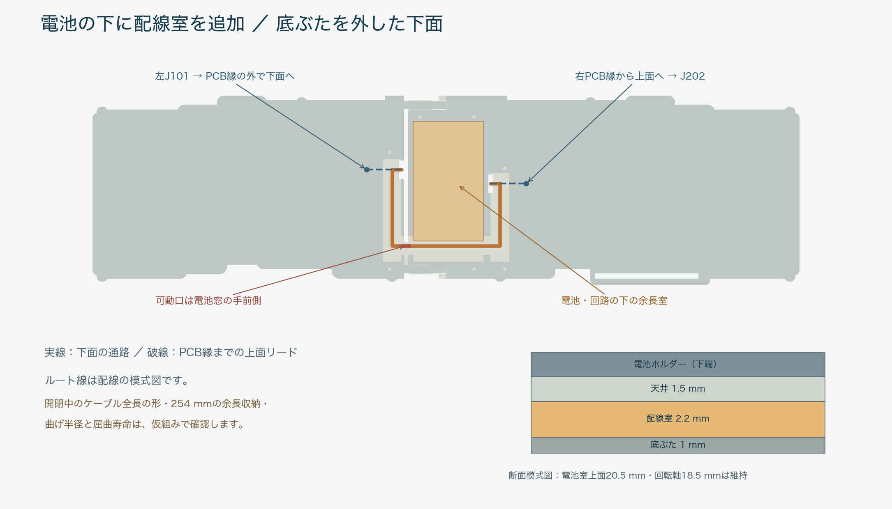

# 電池の下を通す左右接続

**2026-11-24：通路だけを設けた未完成の案。連続するケーブル形状・可動ループは未設計。以下の通路があることを、実ケーブルが収納できる根拠にしない。**

手持ちの76.2 mm・101.6 mmについて、現行の前側可動口を保つ経路では長さが不足する。入口中心とコネクタ中心を直線で結んだ合計は開状態約98.1 mm、90°で約132.1 mm、閉状態約145.5 mm。さらに端子位置をコネクタ包絡内のどこでも許し、通路入口の断面内でも自由に選んで各区間を別々に最短化する、非常に楽観的な下限でも閉状態約124.8 mmとなる。曲げ、障害物、余長、端末が占める長さは無視した下限である。これは**現行の入口配置**に対する判定であり、配置を変更するすべての案を否定するものではない。254 mmは長さ下限を満たすが、収納・屈曲の成立はまだ確認していない。

再計算：[check-cable-length.py](check-cable-length.py)、[数値と対象CADのハッシュ](generated/cable-length-audit.json)。

左右コネクタ用の上面穴だけでは、中央ケースまでの経路は完成していなかった。今回、PCB内側の縁を回る縦スリット、下面の溝、中央電池室の下の配線室、着脱式の底ぶたを追加した。
電池窓の上に置いていた配線用の予約空間は廃止した。

## 経路と寸法

1. 左J101の既存の上面開口でケーブルを接続し、PCB内側の縁の外へ回す。PCBを貫通する穴は開けない。
2. 左の縦スリットから下面の縦溝へ下ろし、手前側の可動口へ導く。
3. 可動部分はY=8〜16 mmの前側で余長を動かす。電池窓はY=20.5〜61.5 mmなので、その上へ横切る経路にはしない。
4. 固定側の可動口から電池室下の配線室・横溝へ入り、右の下面縦溝を通す。
5. 右PCBの縁の外のスリットから上へ戻し、J202へ接続する。

左右とも上面実装のヘッダを残すため、**コネクタからPCBの縁までの短いリードは上面に出る**。電池上面を横切るリードは設けない。

| 箇所 | 設計値 |
|---|---|
| 下面の溝の幅 | 8 mm |
| 配線室の高さ | 2.2 mm（Z=-0.2〜2.0） |
| 中央の余長収納用空間 | 約30×60 mm、電池・回路床の下 |
| 配線室の天井 | Z=2.0〜3.5、厚さ1.5 mm |
| 底ぶた | 厚さ1 mm、下面Z=-1.2 |
| 底ぶたねじ | M2×4、左2本・右5本 |
| 回転軸 | 従来どおりZ=18.5 mm |
| 収納厚 | 39.4 mm（従来37 mmから2.4 mm増） |

底ぶたは [左](generated/left_cable_cover.stl) と [右](generated/right_cable_cover.stl) を個別に印刷する。床を補強して配線室の天井を設け、電池ホルダーの底Z=3.5 mmと電池カバーは外枠Z=15 mm・曲面頂点Z=18 mmへ下げた。回路側のふたはZ=16.3 mmへ下げた。
電池室の旧結束バンド穴は、下のケーブルを引っ掛けないよう今回の補強床では閉じている。ホルダーの保持は端部の囲いとふたの縁を用い、がた・上抜けは実部品で確認する。

## 組立と確認

底ぶたを外した状態で、端末付きケーブルのリボン部分を溝へ横から置く。狭いスリットへIDCコネクタそのものを押し通さない。ねじ穴と電池室の閉じ止め面へ配線を掛けない。
コネクタの方向を実物で確認し、PCB縁までの折り返しでソケットへ横荷重を掛けない。取り付けは底ぶたで線を挟まない状態で行う。

ケーブル幅7.6 mm・厚さ1 mmは通路検討用の仮定。対象は既存のSamtec FFSD-06-D-10.00-01-Nだが、実品の外径・端末の出る向き・曲げ余裕の確認が必要。
[Samtec FFSD製品情報](https://www.samtec.com/products/ffsd)、[アセンブリ図](https://suddendocs.samtec.com/prints/ffsd-xx-x-xx.xx-01-x-x-xxx-mkt.pdf)、[使用電線の図](https://suddendocs.samtec.com/prints/cb-xx-30-7-38-025-gr.pdf)を参照する。

**CADで確認するのは固定通路の貫通、PCBを切らない縦スリット、剛体の開閉干渉まで。ケーブル全長の連続形状と繰返し屈曲は未検証。**
特に開閉で可動口間の経路長が変わるため、余長を配線室から出し入れできることを仮組みで確認する。8 mm幅の直角部でリボンを無理に面内曲げせず、折り返し・ねじれの余裕も確認する。254 mmの既存ケーブルが収納できるかを面積だけで保証しない。

最初は電池・通電なしで、底ぶたを外して開閉し、窓の前側でケーブルが追従すること、壁の角で擦れないこと、コネクタを引っ張らないことを確認する。その後にふたを閉じて再確認する。必要な曲げ半径や固定方法を確定するまでは、本体を強く閉じたり連続開閉したりしない。
